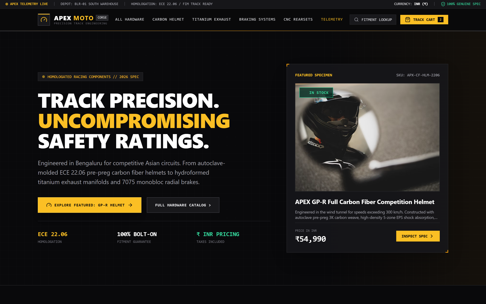
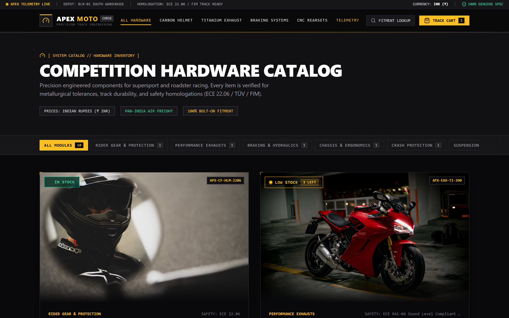
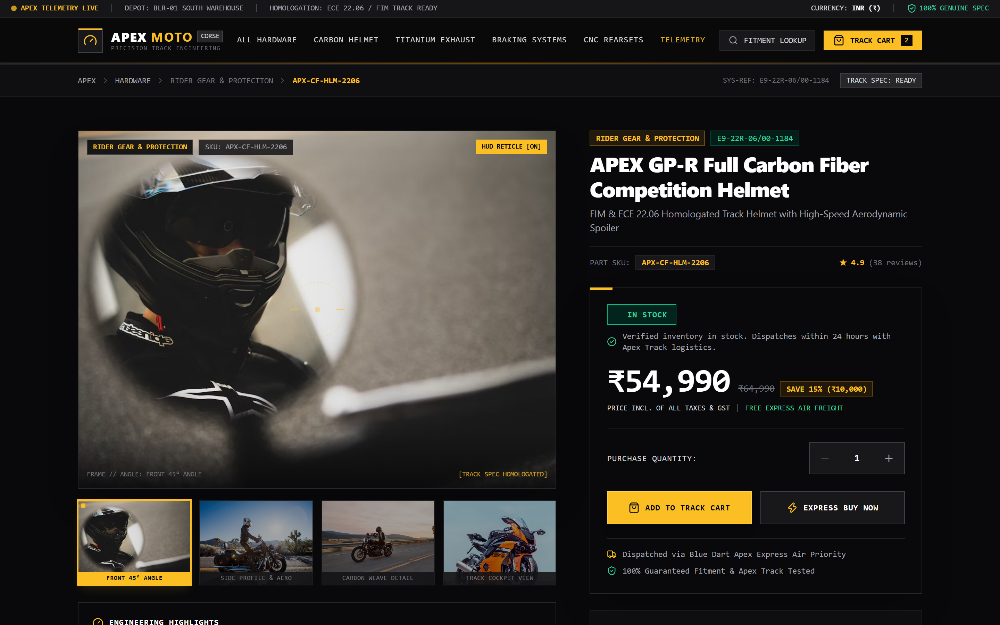
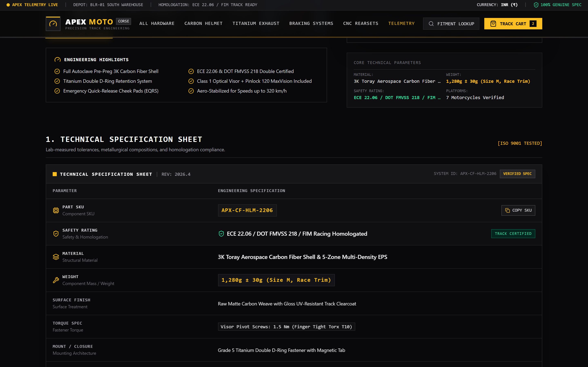
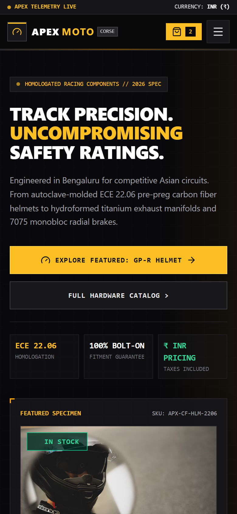
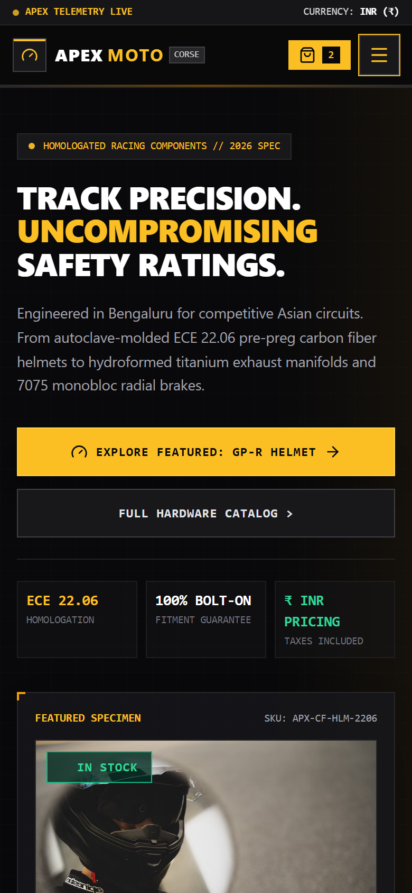
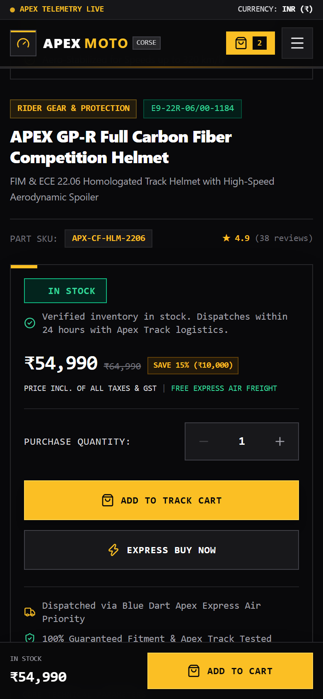
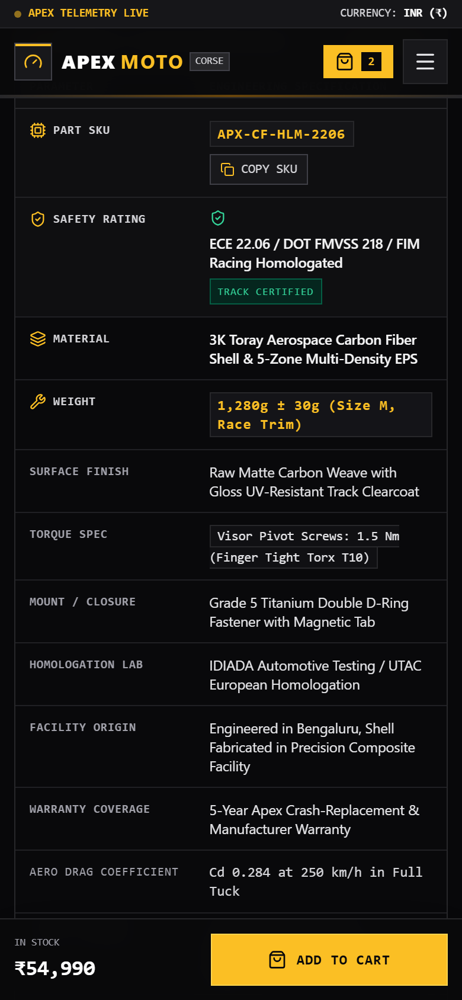

# Apex Moto Corse — Precision Motorcycle Hardware

High-performance motorcycle racing hardware and rider safety equipment e-commerce platform. Built with Next.js 15 (App Router), TypeScript, Tailwind CSS, PostgreSQL (Neon), and Drizzle ORM.

Engineered with an industrial dark-mode moto aesthetic (`#09090b` carbon/gunmetal, `#f59e0b` safety amber accent), strict homologation compliance (ECE 22.06 / FIM), guaranteed CAD bolt-on fitment matrix, and complete mobile-first responsiveness.

---

## 📱 Responsive Showcase (Desktop & Mobile)

### 1. Desktop Experience

| Homepage Hero & Telemetry | Competition Hardware Catalog |
| :---: | :---: |
|  |  |

| HUD Reticle Gallery & Buy Box | Technical Specs & CAD Fitment Matrix |
| :---: | :---: |
|  |  |

---

### 2. Mobile Responsive Experience (iPhone 14 / Pixel / Android)

| Mobile Hero & Touch CTAs | Mobile Navigation Drawer |
| :---: | :---: |
|  |  |

| Sticky Buy Bar (Mobile UX) | Interactive CAD Fitment Tool |
| :---: | :---: |
|  |  |

---

## ✨ Key Engineering Features

- **Fully Responsive Architecture:** Optimized for viewports from 320px ultra-compact phones to 4K desktop screens. Features custom `xs: 480px` breakpoint, fluid typography, and momentum touch scrolling.
- **Mobile Navigation Drawer:** Full-screen slide-down menu with quick motorcycle fitment lookup, homologation status, and hardware links.
- **Mobile Floating Sticky Buy Bar:** Fixed bottom bar for smartphones displaying live stock status, ₹ INR pricing, and immediate cart actions without scrolling back to the top.
- **Interactive Telemetry HUD Reticle:** On-demand targeting crosshairs overlay on product photography with telemetry coordinates and angle selectors.
- **Dynamic Derived Stock Engine:** Stock status (`in_stock`, `low_stock`, `out_of_stock`) derived dynamically from warehouse quantities.
- **CAD Fitment Verification Matrix:** Instant interactive chassis compatibility checker filtering across supersport, streetfighter, and roadster platforms.
- **Zero Raw DB Leakage:** All database queries mapped through strict typed mapper functions before rendering in UI components.

---

## 🛠️ Tech Stack & Commands

- **Framework:** [Next.js](https://nextjs.org) 15 (App Router, Turbopack, Server Components)
- **Language:** [TypeScript](https://www.typescriptlang.org) 5.8
- **Styling:** [Tailwind CSS](https://tailwindcss.com) (Industrial High-Contrast Dark Theme)
- **Database:** PostgreSQL ([Neon Serverless](https://neon.tech)) + [Drizzle ORM](https://orm.drizzle.team)
- **Icons:** [Lucide React](https://lucide.dev)
- **Testing & Verification:** [Puppeteer Core](https://pptr.dev) + Edge Headless

### Getting Started

1. Copy `.env.example` to `.env`:
   ```bash
   cp .env.example .env
   ```
2. Populate `.env` with your Neon database connection string.
3. Install dependencies:
   ```bash
   pnpm install
   ```
4. Run development server:
   ```bash
   pnpm dev
   ```
5. Run TypeScript typecheck:
   ```bash
   pnpm typecheck
   ```
6. Build for production:
   ```bash
   pnpm build
   ```
